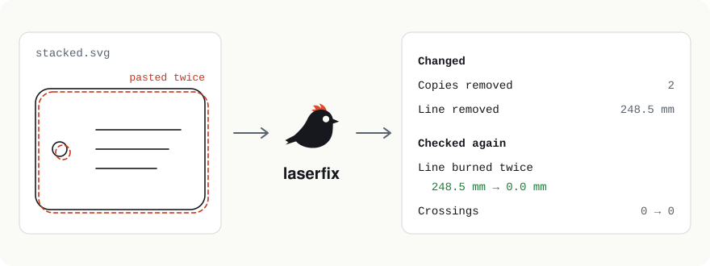

<p align="center">
  <picture>
    <source media="(prefers-color-scheme: dark)" srcset="docs/images/laserfix-hero-dark.svg">
    
  </picture>
</p>

<p align="center">
  <a href="https://github.com/kinglet-dev/laserfix/actions/workflows/ci.yml"></a>
  <a href="https://github.com/kinglet-dev/laserfix/actions/workflows/badges.yml"></a>
  <a href="https://github.com/kinglet-dev/laserfix/releases/latest"></a>
  <a href="LICENSE"></a>
  <a href="go.mod"></a>
</p>

# laserfix

**Repairs an SVG so your laser burns each line once:** it finds shapes that copy an earlier shape, such as an outline pasted in place twice, and writes a copy of the file without them.

It never changes the file you give it. It shows what it would change first, and after writing a repaired copy it measures it again to show the fix worked. It's the "fix" step after [laserlint](https://github.com/kinglet-dev/laserlint)'s "check".

[Documentation](#usage) · [kinglet.dev](https://kinglet.dev/tools/laserfix/) · [Changelog](CHANGELOG.md) · [Security](SECURITY.md) · [Releases](https://github.com/kinglet-dev/laserfix/releases)

## Example

[`examples/stacked.svg`](examples/stacked.svg) is an 80 mm tag whose outline and hole were pasted in place twice, so the laser would cut them twice:

```text
$ laserfix stacked.svg
laserfix 0.1.0 · stacked.svg · 80.0 × 60.0 mm

Would change
  Copies   2 shapes, 248.5 mm of line burned twice → remove the later copy
           at (11.0, 5.0), (18.0, 30.0)

Run again with -o FILE to write the repaired copy.
```

Places are in mm from the top-left corner. Writing the repaired copy:

```text
$ laserfix stacked.svg -o stacked-fixed.svg
laserfix 0.1.0 · stacked.svg → stacked-fixed.svg · 80.0 × 60.0 mm

Changed
  Copies   2 shapes removed, 248.5 mm of line burned twice
           at (11.0, 5.0), (18.0, 30.0)

Checked again
  Line burned twice   248.5 mm → 0.0 mm
  Crossings           0 → 0

Wrote stacked-fixed.svg. Check it with: laserlint stacked-fixed.svg
```

## What it fixes

- **Copies:** a shape is a copy when it has the same fill and stroke as an earlier shape and its line lies within 0.02 mm (`--same`) of it everywhere, wherever it starts and whichever way it runs. The later copy is removed; the earlier one stays. This covers shapes pasted in place, a square drawn from another corner or in the other direction, and a `<circle>` against the same circle drawn as a path.
- **Kept as they were:** every other element and byte of the file: ids, styles, groups, layers, transforms and comments.
- **Shapes of different colors are never copies,** because laser software chooses settings by color.

Trimming lines shared by two shapes, and joining outlines stored as several pieces, are planned next.

## Installation

laserfix is a single program with no other software to install.

1. Download the file for your computer from the [latest release](https://github.com/kinglet-dev/laserfix/releases/latest):

   | Computer | File |
   |---|---|
   | Windows (most PCs) | `laserfix_<version>_windows_amd64.zip` |
   | Windows on Arm | `laserfix_<version>_windows_arm64.zip` |
   | Mac with Apple silicon (M1 and later) | `laserfix_<version>_darwin_arm64.tar.gz` |
   | Mac with Intel | `laserfix_<version>_darwin_amd64.tar.gz` |
   | Linux | `laserfix_<version>_linux_amd64.tar.gz` or `_linux_arm64.tar.gz` |

2. Unpack it and put `laserfix` (`laserfix.exe` on Windows) in a folder on your `PATH`, or run it from where it is.
3. Check it runs: `laserfix --version`.

The programs aren't signed with an Apple or Microsoft certificate yet. On a Mac, if macOS says it can't check the program, run `xattr -d com.apple.quarantine laserfix` once. On Windows, SmartScreen may ask you to confirm the first time.

**Verify a download (optional):** each release has a `laserfix_<version>_checksums.txt` file. Compare it with `sha256sum laserfix_*` (Linux), `shasum -a 256 laserfix_*` (macOS) or `Get-FileHash laserfix_*` (PowerShell). Each archive also has an SBOM (`.sbom.json`) listing what it's built from.

**From source:** with [Go](https://go.dev/dl/) 1.27 or later, run `go install github.com/kinglet-dev/laserfix/cmd/laserfix@latest`.

## Usage

```text
laserfix [flags] FILE          show what would change; write nothing
laserfix [flags] FILE -o OUT   write the repaired copy to OUT
laserfix [flags] - -o -        read standard input, write standard output
```

| Flag | Effect |
|---|---|
| `-o OUT` | Write the repaired copy to `OUT`, a new file; an existing file is never replaced. `-` writes standard output, and the report then goes to standard error. |
| `--same LENGTH` | Lines nearer than this are the same line (default `0.02mm`). Lengths need a unit: `mm`, `cm`, `in`, `pt` or `px`. |
| `--json` | Write the report as JSON (`kinglet.report/v1`), with a `changes` list and the measurements `before` and `after`. |
| `--version` | Show the version. |
| `-h`, `--help` | Show help with examples. |

Flags can come before or after the file.

**Exit status:** `0` nothing left to fix; `1` changes are needed (preview), or the written copy came out worse; `2` the file couldn't be read or written.

**In a pipeline:** `cat stacked.svg | laserfix - -o - | laserlint -`

## Compatibility

- **Systems:** Windows, macOS and Linux, on 64-bit Intel/AMD (`amd64`) and Arm (`arm64`). Tested on all three in CI.
- **SVG:** what [laserlint](https://github.com/kinglet-dev/laserlint#compatibility) reads: `path`, `rect`, `circle`, `ellipse`, `line`, `polyline`, `polygon` and groups, with transforms, `viewBox` and sizes in any unit.
- **Not read yet:** clones (`<use>`), text, embedded images and CSS classes. laserfix stops with the Inkscape fix: Edit → Clone → Unlink Clone, or Path → Object to Path.
- **Limits:** files up to 25 MB and 200,000 elements, so a hostile file can't hang it.

## Configuration

None: there's no configuration file. Everything is set with the flags above.

## Dependencies

laserfix uses the Go standard library and [Kinglet core](https://github.com/kinglet-dev/core) (MIT), the SVG reader and geometry it shares with laserlint. Its tests use [Ginkgo](https://github.com/onsi/ginkgo) and [Gomega](https://github.com/onsi/gomega) (both MIT), which aren't part of the program.

It needs no network connection and sends nothing anywhere.

## Contributing

Issues, bug reports and sample SVGs are very welcome. Outside pull requests need a signed Contributor License Agreement, which isn't set up yet; see [CONTRIBUTING.md](CONTRIBUTING.md).

## Security

Please report vulnerabilities privately, as described in [SECURITY.md](SECURITY.md).

## License

laserfix is released under the [MIT License](LICENSE). The Kinglet name, logo and mascot aren't covered by it; see [TRADEMARKS.md](TRADEMARKS.md).
